# Revue guidée du pipeline ETL multimodal

**Échange avec Sylvain — 20 à 25 minutes**  
**Fil conducteur :** reprendre les cinq attendus du cahier des charges, expliquer
les choix techniques et terminer par une démonstration du pipeline.

---

## 0. Ce que je vais te montrer

Le projet couvre un pipeline de données complet. Son rôle s’arrête à la
préparation, au déplacement et au suivi de publications associant texte et
image : il n’entraîne pas de modèle et ne produit pas de verdict vrai/faux.

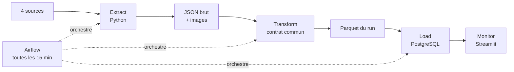

### Parcours de l’échange

| Temps | Attendu du cahier des charges | Ce que je montre |
|---:|---|---|
| 0–3 min | Explorer les sources | choix des quatre sources et des outils |
| 3–8 min | Extraire | modules Python, robustesse et texte-image |
| 8–12 min | Transformer | lot courant, mapping, validation et schéma |
| 12–17 min | Charger et orchestrer | DAG Airflow, PostgreSQL et sécurité |
| 17–20 min | Mesurer et surveiller | KPI, seuils et tableau de bord |
| 20–23 min | Prouver le fonctionnement | démonstration guidée |
| 23–25 min | Faire le bilan | limites, difficultés et suites possibles |

### Stack technique en une vue

| Besoin | Technologie | Pourquoi ce choix |
|---|---|---|
| appels HTTP et images | Requests | API, flux, HTML et fichiers avec la même base HTTP |
| RSS et Atom | Feedparser | transforme directement les entrées XML en objets Python |
| HTML statique | Beautiful Soup | ciblage simple du titre, du texte et de l’image |
| dataset tabulaire | `csv.DictReader` | lecture progressive du TSV sans le charger en mémoire |
| transformation | Python + pandas | règles explicites puis export typé en Parquet |
| orchestration | Apache Airflow | dépendances, planification, retries, logs et exécution locale |
| stockage métier | PostgreSQL | types, contraintes, transaction et upsert |
| pilotage | Streamlit | KPI lisibles et interactifs avec peu de code d’interface |

---

## 1. Exploration : quatre sources réellement complémentaires

Le rapport E01 ne se limite pas à une liste. Pour chaque source, j’ai qualifié
les modalités, le format, la langue, les labels, la méthode d’accès et les
limites d’usage. J’ai ensuite retenu quatre sources qui permettent de montrer
quatre situations d’extraction différentes.

| Source retenue | Données | Accès et format | Labels | Outil utilisé |
|---|---|---|---|---|
| **NewsData.io** | article, résumé, image, date, source | API REST, JSON | absents | Requests |
| **PolitiFact** | affirmation, explication, verdict, vignette | RSS/XML + HTML | verdict éditorial | Requests + Feedparser |
| **Fakeddit** | titre Reddit, image, métadonnées sociales | TSV + URLs | 2, 3 et 6 classes | `csv.DictReader` + Requests |
| **The Conversation France** | article, auteur, date, image | Atom + pages HTML | absents | Feedparser + Requests + Beautiful Soup |

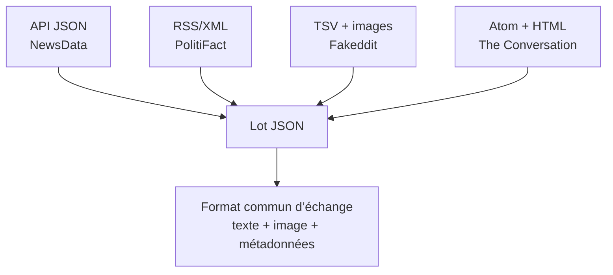

### Pourquoi ces choix ?

- ils couvrent API, flux, fichier tabulaire et scraping HTML statique ;
- ils contiennent réellement une association entre texte et image ;
- PolitiFact et Fakeddit apportent des labels, avec deux niveaux de fiabilité
  différents ;
- NewsData et The Conversation apportent du contenu français récent ;
- Scrapy serait utile à plus grande échelle, mais ajouterait ici de la
  complexité ;
- Selenium n’est pas justifié puisque les pages retenues ne nécessitent pas
  l’exécution de JavaScript pour accéder aux données ciblées.

> Une source d’actualité n’est pas considérée comme « vraie » par défaut. Le
> pipeline conserve uniquement les labels existants et leur provenance.

**Attendu couvert :** rapport structuré, plus de trois sources variées, formats
et méthodes d’extraction décrits, formats de déplacement anticipés.

---

## 2. Extraction : un module, une responsabilité

J’ai séparé les fonctionnalités pour que chaque fichier ait un rôle lisible et
qu’une nouvelle source puisse être ajoutée sans modifier les autres
extracteurs.

```text
scripts/
├── common.py                    fonctions HTTP, images, logs et JSON partagées
├── extract_newsdata.py          API REST JSON
├── extract_politifact.py        flux RSS
├── extract_fakeddit.py          TSV incrémental
├── extract_theconversation.py   Atom puis HTML avec Beautiful Soup
└── run_extractions.py           lancement autonome des quatre sources
```

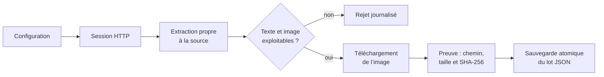

### Ce que centralise `common.py`

| Fonction | Responsabilité |
|---|---|
| `configure_logging()` | même format de logs dans le terminal et les fichiers |
| `create_http_session()` | User-Agent, retries et prise en compte de `Retry-After` |
| `download_image()` | MIME, taille maximale et écriture temporaire `.part` |
| `reusable_image()` | cohérence entre image locale et métadonnées de provenance |
| `save_json_records()` | enveloppe commune et écriture JSON atomique |

### Robustesse mise en place

- timeouts de connexion et de lecture ;
- trois nouvelles tentatives pour les erreurs HTTP temporaires ;
- gestion des statuts 429, 500, 502, 503 et 504 ;
- contrôle du type MIME et limite de 10 Mo par image ;
- `try/except`, logs contextualisés et code de sortie non nul sur échec global ;
- aucun fichier final tant que son écriture n’est pas terminée ;
- clé NewsData lue depuis l’environnement, jamais inscrite dans le code.

### L’association texte-image est vérifiable

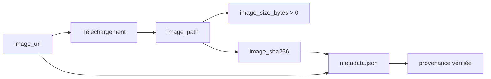

### Fakeddit avance réellement dans le TSV

Le fichier de 149 Mo est parcouru progressivement. Le curseur ne change
qu’après la sauvegarde réussie du lot.

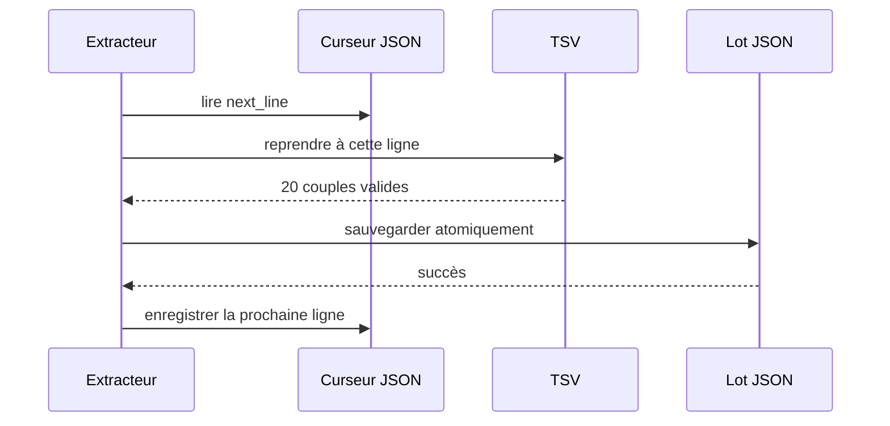

| NewsData | PolitiFact | Fakeddit | The Conversation | Total nominal |
|---:|---:|---:|---:|---:|
| 10 | 20 | 20 | 10 | **60** |

**Attendu couvert :** scripts autonomes, fonctions claires, gestion des erreurs,
logs et données multimodales prêtes à être transformées.

---

## 3. Transformation : uniquement les quatre lots du run

Le point important de l’architecture incrémentale est ici : Airflow transmet
par XCom les quatre chemins créés pendant le run. La transformation exige
exactement un fichier pour chacune des quatre sources et ne parcourt jamais les
anciens lots présents sur disque.

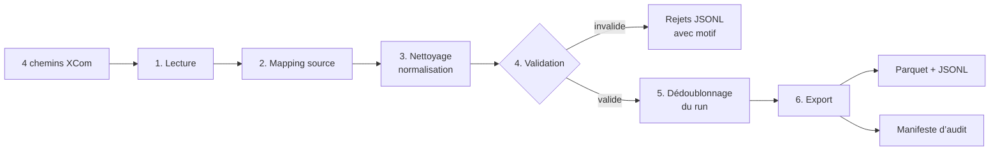

### Exemples de transformations

| Source | Mapping spécifique |
|---|---|
| NewsData.io | repli `content → description → ai_summary`, langue normalisée |
| PolitiFact | HTML vers texte et extraction du verdict éditorial |
| Fakeddit | timestamp Unix vers UTC, conservation des trois jeux de labels |
| The Conversation | nettoyage HTML, langue française et licence conservée en brut |

### Reproductibilité et traçabilité

- paramètres explicites : fichiers d’entrée, politique de doublon et format de
  sortie ;
- même ordre de colonnes et mêmes types à chaque exécution ;
- motif conservé pour chaque rejet ;
- manifeste avec version de schéma, paramètres, volumes et SHA-256 des entrées,
  du pipeline et des sorties ;
- une métrique enregistrée pour chaque famille de transformations.

### Contrat final : une publication et son image principale

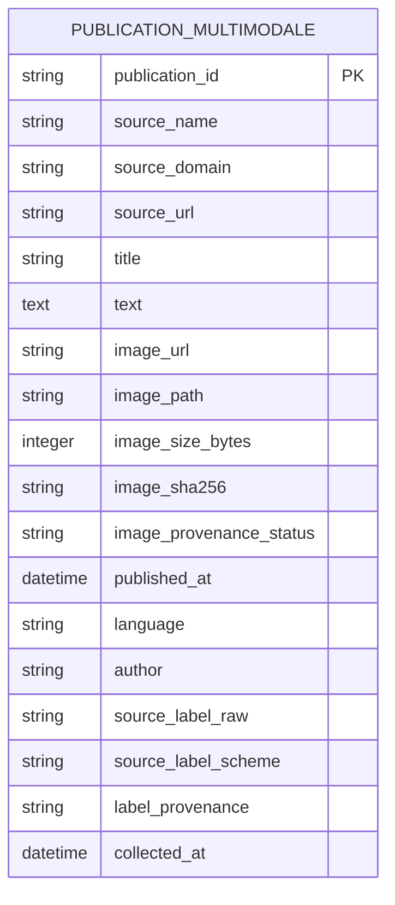

Une seule table suffit car le grain est une publication avec une image
principale. Le texte et l’image ont le même cycle de vie ; les séparer créerait
une jointure sans apporter de relation métier supplémentaire.

| Source | Construction de `publication_id` |
|---|---|
| NewsData.io | préfixe `newsdata_` + identifiant API |
| PolitiFact | préfixe `politifact_` + hash stable de l’ID RSS ou de l’URL |
| Fakeddit | préfixe `fakeddit_` + ID Reddit |
| The Conversation | préfixe `theconversation_` + ID article ou hash de l’URL |

**Attendu couvert :** pipeline lecture–traitement–export, paramètres
configurables, logs de transformation, schéma lisible et lien texte-image
garanti par la clé primaire et les contraintes.

---

## 4. Airflow et PostgreSQL : orchestrer puis charger l’incrément

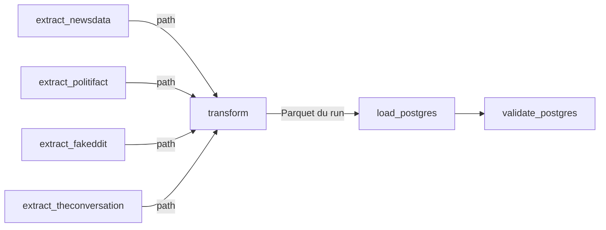

Le DAG sépare sept responsabilités. Les quatre extractions peuvent s’exécuter
en parallèle ; Transform attend les quatre succès ; Load et Validate restent
séquentiels. Les `PythonOperator` appellent les fonctions des scripts : le DAG
n’embarque pas une seconde implémentation de l’ETL.

### Configuration opérationnelle

| Réglage | Valeur | Rôle |
|---|---|---|
| planification | `*/15 * * * *` | un run à chaque quart d’heure |
| `catchup` | `False` | pas de création rétroactive de périodes |
| `max_active_runs` | `1` | protection du curseur et des sorties locales |
| retries | 2, espacés de 2 min | absorption des incidents temporaires |
| opérateurs | 7 `PythonOperator` | tâches courtes et responsabilités visibles |

### Pourquoi PostgreSQL ?

- le contrat final est tabulaire et stable ;
- les types et contraintes protègent la qualité ;
- le chargement est transactionnel avec rollback sur erreur ;
- `ON CONFLICT (publication_id) DO UPDATE` rend le chargement idempotent ;
- les contrôles de volume, de PK et de multimodalité sont simples en SQL.

Les images restent dans `data/images/`. PostgreSQL conserve leur chemin, leur
URL, leur taille et leur empreinte : la base reste légère tout en garantissant
le lien avec le fichier.

### Sécurité appliquée

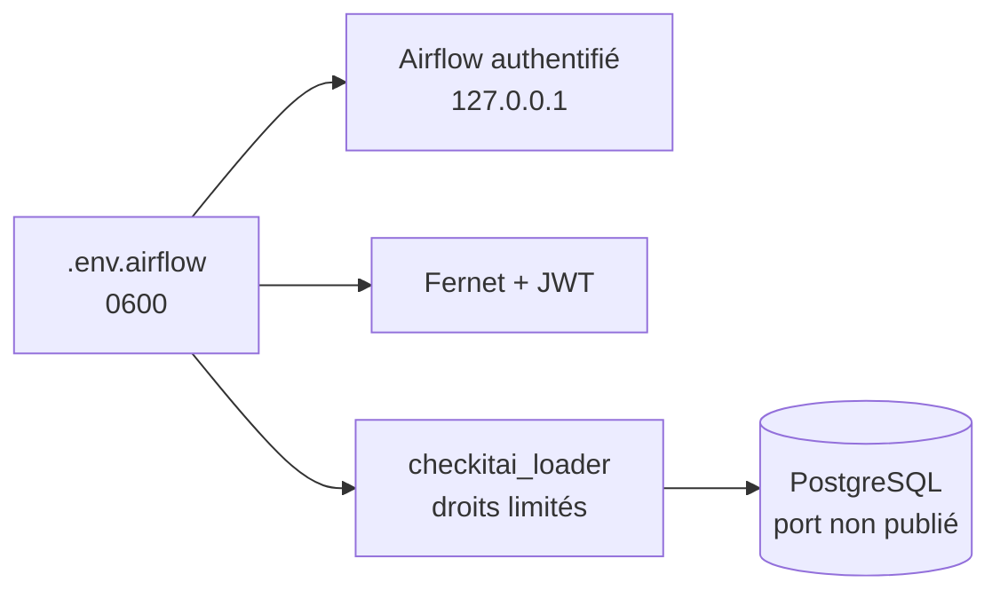

- secrets absents du code, du DAG, des logs et de Git ;
- interface Airflow limitée à la machine locale ;
- bases accessibles uniquement sur le réseau Docker ;
- rôle `checkitai_loader` sans droits superutilisateur, création de base ou de
  rôle ;
- scripts montés en lecture seule dans les conteneurs Airflow.

**Attendu couvert :** DAG exécutable, tâches Extract/Transform/Load séparées,
base adaptée et choix de sécurité explicites.

---

## 5. KPI et monitoring : rendre le pipeline lisible

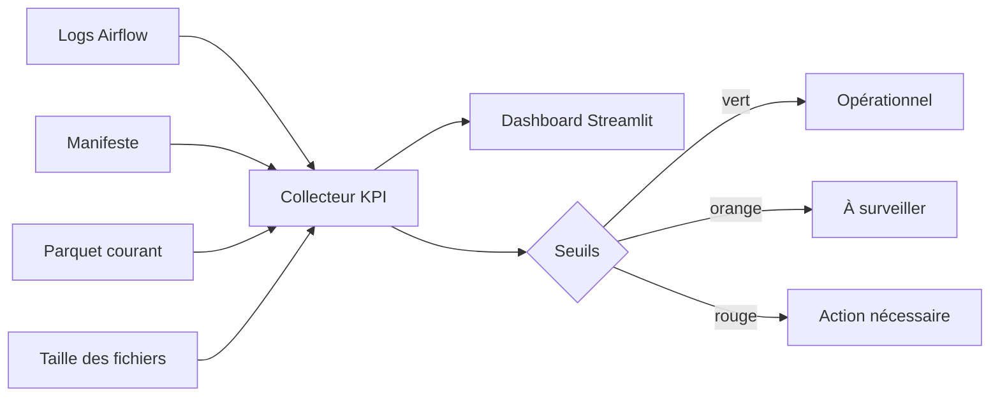

### Indicateurs retenus

| Axe | KPI | Ce qu’il permet de voir |
|---|---|---|
| qualité | taux de validité | conformité au contrat de données |
| qualité | complétude multimodale | texte et preuve d’image présents |
| qualité | rejets, doublons, labels | pertes et couverture des labels |
| rapidité | durée du run et des tâches | ralentissement global ou localisé |
| fiabilité | succès et fraîcheur | régularité du pipeline |
| coût | calcul et stockage estimés | ordre de grandeur et tendance |

> La « validité » mesure la conformité au contrat ETL. Ce n’est pas la
> précision d’un modèle de détection.

| KPI | Cible | Avertissement | Critique |
|---|---:|---:|---:|
| validité | ≥ 98 % | < 98 % | < 95 % |
| texte + image | ≥ 99 % | < 99 % | < 97 % |
| taux de succès | ≥ 95 % | < 95 % | < 90 % |
| durée d’un run | < 60 s | ≥ 60 s | ≥ 120 s |
| âge du dernier succès | < 30 min | ≥ 30 min | ≥ 60 min |

Le dashboard comporte quatre vues : **Qualité**, **Performance**, **Coût** et
**Détails**. Les tarifs utilisés pour l’estimation sont modifiables dans la
barre latérale.

### Réaction prévue en cas d’incident

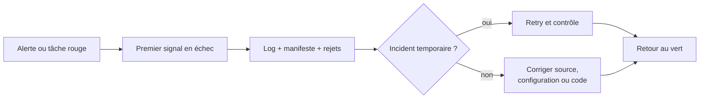

**Attendu couvert :** dashboard interactif compréhensible, KPI de qualité,
rapidité et coût, seuils, fréquence des contrôles et procédure d’incident.

---

## 6. Démonstration guidée

### 1 — Vérifier le DAG dans Airflow

- ouvrir <http://localhost:8080> ;
- montrer les sept tâches et leurs dépendances dans la vue Graph ;
- ouvrir le dernier run `scheduled__` ;
- montrer un log d’extraction puis `validate_postgres`.

### 2 — Vérifier que Transform n’a pris que le run courant

```bash
jq '{
  mode: .parameters.processing_mode,
  total: .accepted_count,
  sources: [.inputs[] | {source, path, lignes: .raw_count}]
}' data/processed/transformation_manifest.json
```

Résultat attendu : mode `incremental_exact_batches`, quatre chemins et 60
publications pour un lot nominal complet.

### 3 — Montrer l’avancement de Fakeddit

```bash
jq . data/state/fakeddit_cursor.json
```

Le champ `next_line` doit avancer après chaque run réussi.

### 4 — Contrôler PostgreSQL sans afficher de secret

```bash
docker compose --env-file .env.airflow -f docker-compose.airflow.yml \
  exec -T warehouse sh -lc \
  'psql -U "$WAREHOUSE_USER" -d "$POSTGRES_DB" -c "
    SELECT
      COUNT(*) AS total,
      COUNT(DISTINCT publication_id) AS ids_uniques,
      COUNT(*) FILTER (
        WHERE image_path IS NULL OR image_sha256 IS NULL
      ) AS associations_invalides
    FROM publication_multimodale;
  "'
```

Le total peut augmenter avec le scheduler. `total` et `ids_uniques` doivent
rester égaux, et `associations_invalides` doit rester à zéro.

### 5 — Terminer dans Streamlit

```bash
uv run streamlit run dashboard/etl_kpi_dashboard.py
```

- montrer le bandeau de santé ;
- parcourir Qualité, Performance et Coût ;
- rappeler que le lot courant et l’historique des runs sont deux vues
  complémentaires.

### Instantané de validation du 7 septembre 2026

| Contrôle | Résultat observé |
|---|---:|
| dernier DAG | 7 tâches sur 7 en succès |
| durée | 15,0 s |
| lot transformé | 60 publications |
| rejets / doublons du run | 0 / 0 |
| PostgreSQL après trois runs | 104 lignes, 104 PK distinctes |
| associations multimodales invalides | 0 |
| curseur Fakeddit | ligne suivante : 68 |
| tests | 18 tests + Ruff réussis |

---

## 7. Les décisions à retenir

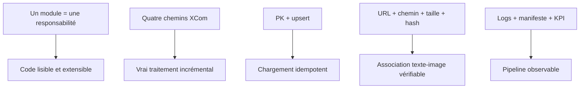

### Difficultés principales

- homogénéiser quatre formats sans perdre les champs utiles ;
- fiabiliser le téléchargement et la réutilisation des images ;
- distinguer dédoublonnage du run et idempotence en base ;
- rendre Fakeddit incrémental sans relire le TSV ;
- produire des KPI compréhensibles à partir des logs techniques.

### Limites connues

- disponibilité et quotas des sources distantes ;
- URLs Fakeddit susceptibles de vieillir ;
- stockage local des images ;
- alertes actuellement visuelles ;
- absence volontaire de modèle de classification dans ce périmètre.

### Suites possibles

- stockage objet pour les images ;
- historique PostgreSQL des KPI ;
- notifications Airflow ;
- TLS et gestionnaire de secrets pour un déploiement distant ;
- versionnement des jeux de données destinés à un futur usage IA.

## Conclusion de l’échange

Le projet répond aux cinq attendus avec une seule chaîne de traitement : quatre
sources multimodales, des extracteurs modulaires, une transformation strictement
incrémentale, un chargement PostgreSQL idempotent, une orchestration Airflow et
un monitoring Streamlit. Les choix structurants sont visibles dans le code et
vérifiables pendant la démonstration.
